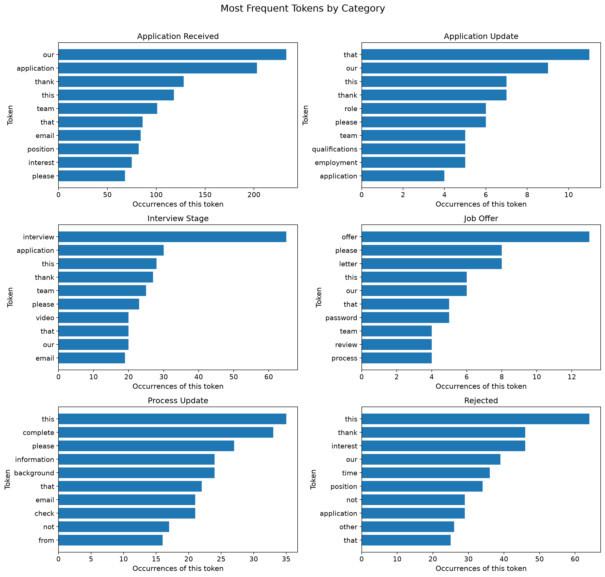

[](pyproject.toml)
[](https://docs.astral.sh/uv/)

# nlp-03-text-exploration-context

**Alex Heyert | 2026-11**

## Project Overview

This project explores a corpus of emails from different stages of the application process with Python and Polars. Most rejection emails sound the same, so I'm exploring how similar (or different) the email language is.

This project compares categories (job stages) and explores word relationships through co-occurrence, bigrams, and trigrams. These techniques provide foundations for understanding more advanced NLP methods.

I realize it's ironic that ChatGPT used NLP to categorize the email text, but classification to create a corpus was not my goal.

## Data Source

I used ChatGPT to create a CSV corpus of incoming job related emails from two linked Gmail inboxes, searching messages dated September 1, 2025, through November 8, 2026. The CSV contains 202 messages in six categories: application received, application update, interview stage, job offer, process update, and rejected.

ChatGPT removed detected personal names and contact details while retaining company names. The CSV is private and is not included in this repository. Add `job_messages.csv` to the local `data/` directory to run the notebook.

## Results



More results and interpretation are in the [project documentation](https://ajaneh.github.io/nlp-03-text-exploration-context/).

## Run the Project

Follow the [Professional Python Workflow Guide](https://denisecase.github.io/pro-analytics-02/) for additional instructions on setting up your machine and project environment.

### Initialize and Update the Python Environment

With the project open in VS Code, open a VS Code terminal.
Paste each command and hit Enter or Return after to run it.

```shell
uvx pup-clean --delete
uv self update
uv python pin 3.14
uv python install
uv lock --upgrade
uv add --dev ipykernel
uv sync
uv audit
```

### Run the Notebook

Go to [notebooks](notebooks/nlp_corpus_heyert.ipynb).
Select Kernel and Run all.
See the notebook for specific data usage instructions.

### Set Up and Run Git Hooks

Set up and run the git hooks to perform
basic checks automatically before
any changes get pushed to GitHub.

In the VS Code terminal,
paste each command and hit Enter or Return after to run it.

```shell
uvx prek install --force
uvx prek update --freeze --cooldown-days 7

git add -A
uvx prek run --all-files
# repeat if changes were made
uvx prek run --all-files
```

### Run Common Chores

Run linters, formatters, type checks, tests, and
build the documentation.

```shell
uv run ruff check . --fix
uv run ruff format .

uv run ty check
uv run python -m pytest
uv run python -m zensical build
```

### Git add-commit-push to GitHub

After making useful changes, save your work to GitHub.

```shell
git add -A
git commit -m "describe your changes in quotes"
git push -u origin main
```

### Developer Notes

- Use the **UP ARROW** and **DOWN ARROW** in the terminal to scroll through past commands.
- Use `CTRL+f` to find (and replace) text within a file.

## Developer Tools

This project uses professional Python tools to support development,
testing, documentation, and code quality.

- [uv](https://docs.astral.sh/uv/) - Python environments and dependencies.
- [Ruff](https://docs.astral.sh/ruff/) - Python linting and formatting, configured in [.ruff.toml](.ruff.toml).
- [ty](https://docs.astral.sh/ty/) - Python type checking.
- [pytest](https://docs.pytest.org/) - automated Python tests, configured in [.pytest.toml](.pytest.toml).
- [prek](https://prek.j178.dev/) - Git hooks and automated checks, configured in [prek.toml](prek.toml).
- [Zensical](https://zensical.org/) - project documentation, configured in [zensical.toml](zensical.toml).

## Project Documentation

Project documentation is in the [docs/](docs/) directory and is built using Zensical.

## Links

- [Project documentation](https://ajaneh.github.io/nlp-03-text-exploration-context/)
- [Example project adapted](https://github.com/denisecase/nlp-03-text-exploration)
- [Gmail](https://mail.google.com/) - the private source of the messages; the corpus is not published.
- [Professional Python Workflow Guide](https://denisecase.github.io/pro-analytics-02/)
- [Citation](CITATION.cff)
- [License](LICENSE)
