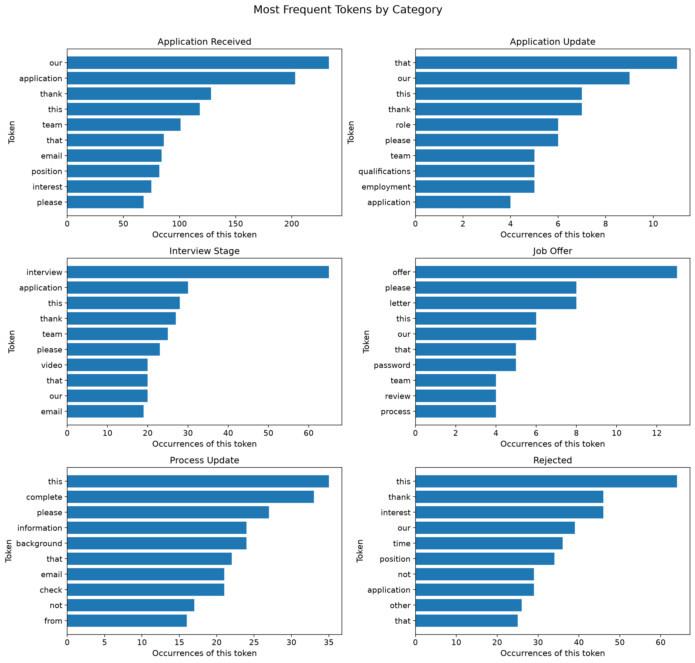
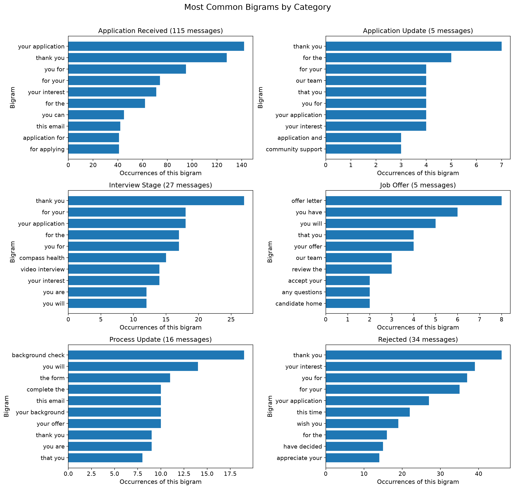
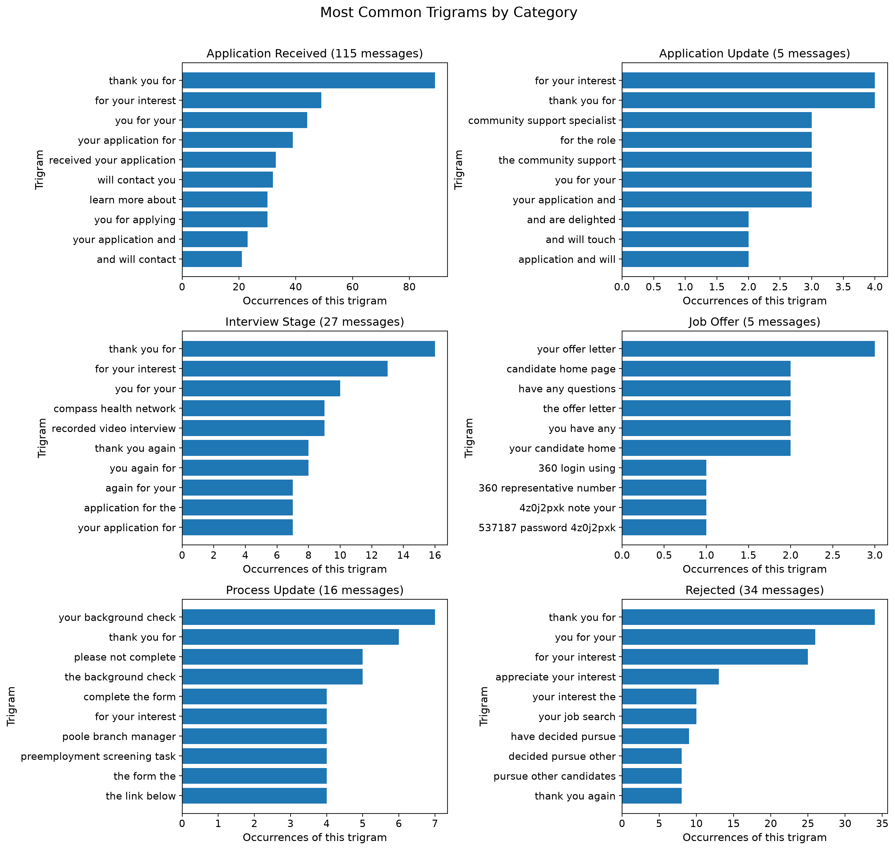

# Web Mining | Project 03

**Alex Heyert | 2026-11**

## Overview

Most rejection emails sound the same, so I'm exploring how similar (or different) the email language is. This project uses Python and Polars to compare job application messages across categories and look at common words and phrases.

## Data

The corpus is a CSV of incoming job related email messages from two linked Gmail inboxes. I used ChatGPT to assemble and categorize the messages dated September 1, 2025, through November 8, 2026. ChatGPT removed detected personal names and contact details while retaining company names. I chose this route because other helpful job search text remains inaccesible and difficult to properly format.

There are 202 documents (emails). The notebook reads the category (job stage) and text fields for analysis.

The CSV is private and is not included in this repository. Add `job_messages.csv` to the local `data/` directory to run the notebook. The messages themselves are not publicly available.

## Techniques Applied

- **Python and Polars** load the CSV, clean and tokenize the message text, and count words and phrases.
- **Matplotlib** makes category comparison charts.
- **Token frequencies** show common words overall and within each category.
- **Immediate-neighbor co-occurrence** counts words that occur directly before or after another word.
- **Bigrams and trigrams** count consecutive two-word and three-word sequences.
- **Jupyter Notebook** combines the code, tables, charts, and explanations in [Notebook](../notebooks/nlp_corpus_heyert.ipynb).

## Custom Modifications

I adapted the example text-exploration project to use my job application email corpus and its six categories: application received, application update, interview stage, job offer, process update, and rejected.

Analysis was done for category token counts and charts, co occurrences, bigram and trigram counts and category charts, and a summary that lists frequent and category exclusive phrases. The category charts show the ten most frequent items in each category.

The tokenizer lowercases text, splits on whitespace, removes characters that are not letters or numbers, and drops tokens of two characters or fewer. For example, `job-related` becomes `jobrelated`. Only overall and per category token frequency counts use the filter out stop words. Token sequence is preserved for the rest of the analysis (except for dropping tokens shorter than three characters)

## Methods and Settings

- **Input:** `data/job_messages.csv`; each row is one email message.
- **Fields analyzed:** `category` and `text`. The notebook assigns each row a message ID so word sequences stay within their original message.
- **Tokenization:** lowercase, split on whitespace, keep Unicode letters and numbers, and discard tokens of length two or fewer.
- **Stop words:** the configured list is removed from overall and per-category token-frequency counts. It is not removed for co-occurrences or n-grams.
- **Co-occurrence window:** one token immediately before or after the target, within the same message.
- **N-grams:** consecutive two-token and three-token sequences within the same message. The top ten overall are displayed, and category charts show each category's top ten.
- **Category-exclusive phrase examples:** a phrase is called exclusive when it occurs in only one of the six corpus categories. This describes this dataset, not all job emails.

## Verification

The notebook code was run against the local CSV. The results look sensible, and the documentation build completed.

## Results

The corpus contains 202 messages:

| Category | Messages |
|---|---:|
| Application received | 115 |
| Application update | 5 |
| Interview stage | 27 |
| Job offer | 5 |
| Process update | 16 |
| Rejected | 34 |

The bigrams and trigrams have significant overlap, a trigram chart may have been unnecesary.

## Observations

- In the process update panels, `background check` occurs 19 times. The notebook's phrase count table shows those phrases appeared in 8 messages.
- In the rejected panel, `pursue other candidates` occurs eight times, across eight messages. `decided pursue` occurs nine times across nine messages. The tokenizer removes `to`, so `decided to pursue` becomes `decided pursue`.
- The interview stage panel includes `video interview`; the job offer panel includes `the offer letter`.
- The notebook's phrase count table shows `your interest` in 23 rejected messages and 61 application received messages.

## Interpretation and Insights

A lot of the messages use familiar recruiting language. The bigram and trigram charts show repeated polite phrases across categories. A bigram and a trigram can come from the same stretch of text, so counting both does not mean they are separate ideas.

Some phrases match the message stages: process updates mention background checks, and rejected messages use phrases about pursuing other candidates. `your interest` appears in both rejected and application received messages, so it looks like general recruiting wording rather than a phrase specific to rejection.

The category labels broadly match my experience. I estimate around 400 other applications never acknowledged my submission. That is my estimate, not something this dataset can measure.

## Limitations

- The corpus is a private, curated set of messages, not a complete record of every application or a count of unique jobs.
- Third-party websites were excluded to prevent excessive repeats, so the corpus cannot show how many applications from those websites received no acknowledgment.
- Repeated messages from the same company may remain in the corpus.
- Only five messages are in each of the application-update and job-offer categories, so a few messages can strongly affect those category counts.
- ChatGPT categorized the messages. Those categories are useful for this exploration but are not an independent measurement of hiring outcomes.
- The simple tokenizer removes short words which affects the exact n-grams counted.

## Next Steps

- Review repeated messages from the same company and decide whether to remove exact duplicates.
- Continue checking category-exclusive phrases against the original messages, which are kept locally for privacy.
- If adding more messages, include the source and date range and rerun the notebook to see whether the phrase patterns persist.

## Project Links

- [Project repository](https://github.com/ajaneh/nlp-03-text-exploration-context)
- [Example project adapted](https://github.com/denisecase/nlp-03-text-exploration)
- [Data source: Gmail](https://mail.google.com/) — private messages; the corpus is not published.
- [Project notebook](../notebooks/nlp_corpus_heyert.ipynb)
